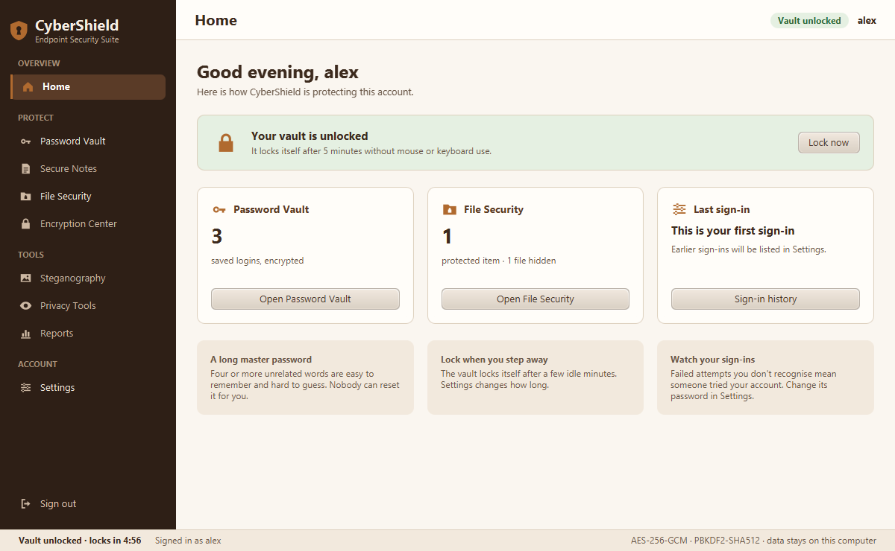
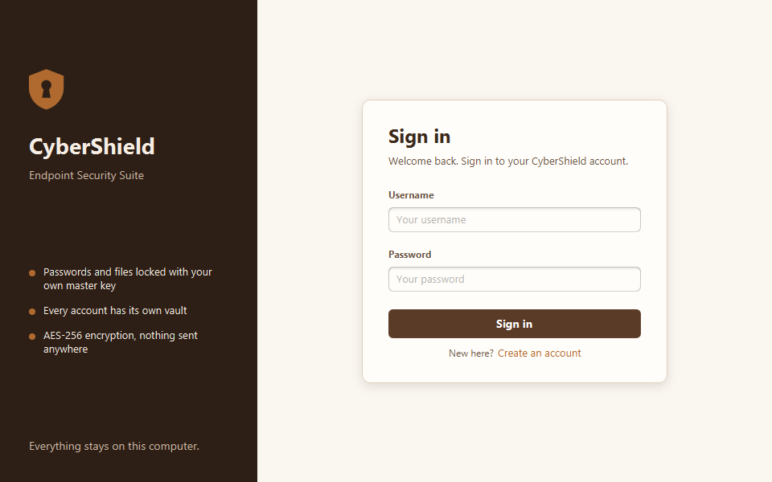
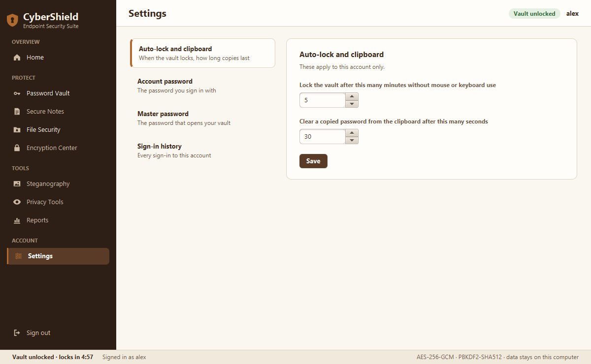

# CyberShield Endpoint Security Suite

A Windows desktop app that keeps passwords and files private on a shared PC. Every account has its own encrypted vault, and nothing leaves the computer. Built with Java 21, JavaFX 21 and SQLite.



## Features

**Accounts**
- Register and sign in. Mistakes show under the form, and Enter signs in.
- After 5 failed attempts the account waits 30 seconds. The wait doubles with each further failure, up to 15 minutes. Unknown usernames get the same answers and waits, so they don't reveal which accounts exist.
- Every sign-in attempt is recorded (time, computer, result, sign-out time) and listed in Settings.

**Vault (one per account)**
- A master password opens the account's vault, and the vault locks itself after a few idle minutes.
- Changing the master password is instant: only the lock on the vault key changes, not the data.

**Password Vault**
- Save, edit, delete and search logins.
- Password generator and strength meter.
- Copy with an automatic clipboard clear (the delay is set in Settings).

**File Security**
- Pick files and folders from anywhere: browse, tick, drag and drop, or Add files / Add folder.
- They are encrypted into a hidden store and the originals are wiped. Restore puts them back exactly: names, times and attributes.
- A private viewer shows photos, text and code, PDFs, video and music inside CyberShield only, with copying blocked.

**Settings**
- Auto-lock minutes and clipboard clear time, per account.
- Change the account password or the master password.
- Sign-in history.

**Coming next** (see the roadmap below): Secure Notes, Encryption Center, Steganography, Privacy Tools, Reports.

## Screenshots

| Sign in | Password Vault |
|---|---|
|  |  |
| **File Security** | **Settings** |
|  |  |

## Requirements

- Windows 10 or 11. File Security uses Windows file attributes; the rest runs anywhere Java does.
- JDK 21 or newer.
- Maven 3.9 or newer.

## Run

```
mvn javafx:run
```

From IntelliJ IDEA, open the project as a Maven project and run the `javafx:run` goal from the Maven tool window (Plugins → javafx). That goal passes the one JVM option the video player needs:

```
--add-exports javafx.media/com.sun.media.jfxmedia.locator=ALL-UNNAMED
```

## Test

```
mvn test
```

The tests cover:
- encryption and the protected-file format, including tampering;
- vaults: creating, unlocking, changing the master password, the PBKDF2 upgrade, and taking over the old shared vault;
- sign-in, waits and history, and registration rules;
- File Security: protect, restore, the safety rules, export and the viewer's decoding;
- settings, and every screen opening.

Each test uses its own database and file store in a temp folder, so the real data is never touched. `ScreensTest` opens the screens with JavaFX (in windows that are never shown), so it needs a desktop session.

To save a picture of every screen:

```
mvn test -Dtest=ScreensTest -Dcybershield.snapshots=target/screens
```

## Where data is kept

| What | Where |
|---|---|
| Accounts, encrypted logins, settings, sign-in history | `database/cybershield.db` in the folder the app runs from |
| Encrypted protected files (hidden and system folder) | `%LOCALAPPDATA%\CyberShield\FileVault` |
| A copy of each vault's wrapped key, for recovery | `%LOCALAPPDATA%\CyberShield\FileVault\keys` |

The database is not in git (see `.gitignore`).

## Security design

**Account passwords** are stored as BCrypt hashes.

**Vaults**
- Each vault has a random 256-bit key. It is stored only wrapped with AES-256-GCM, under a key derived from the master password with PBKDF2-HMAC-SHA512 (210,000 rounds, 16-byte random salt).
- Changing the master password rewraps that one key in one transaction. Vaults wrapped with fewer rounds are rewrapped on their next unlock.

**Saved data** is encrypted with AES-256-GCM and a fresh 12-byte IV for every value.

**Protected files** use the CSF1 format:
- Every file gets its own random key, wrapped with the vault key.
- Data is encrypted in 1 MiB chunks, with nonces built from a block type and a counter.
- The header is authenticated with every block, so changed, reordered, moved or cut-off blocks are refused.
- An original is replaced only after its encrypted copy has been written, flushed to disk and read back. It is then overwritten and deleted.

**If the database is lost**, the master password and the key file in `keys\` still open the files. A recovery tool is on the roadmap.

**Limits**
- Overwriting a file doesn't guarantee it is gone from an SSD.
- Video playback uses an internal JavaFX class, so re-test it when JavaFX is upgraded.

### Upgrading from v1

In v1 all accounts shared one vault. The first time an account that has items in it opens the vault after updating, CyberShield asks for that vault's master password once. Its items then move into the account's own vault, with the same key, now wrapped with 210,000 rounds. Accounts with nothing in the shared vault set up their own. The shared vault is removed once no account has items left in it.

## Design

- **Colours:** warm off-white and brown in a 60-30-10 split. Off-white paper covers most of the screen, brown gives the structure (sidebar, headings, main buttons), and one caramel accent marks focus and highlights.
- **Layout:** follows the rule of thirds. Lists, navigation and explanations take one third and the main content the other two, and summary cards come three to a row.
- **One stylesheet:** the palette lives in `src/main/resources/css/theme.css`.

## Project layout

```
src/main/java/com/cybershield/
  app/          entry point
  config/       paths and constants
  database/     schema set-up and upgrades
  dao/          users, sign-in history, settings
  encryption/   AES-GCM, PBKDF2, the CSF1 file format
  files/        File Security: protect, hide, restore, view
  password/     Password Vault data
  security/     BCrypt, session
  services/     sign-in and registration, the open vault key
  vault/        per-account vaults, auto-lock, key backup
  ui/           screens (controllers) and the file viewer
  utils/        validation, generator, formatting
src/main/resources/
  fxml/         screen layouts
  css/          theme.css and one stylesheet per screen
  sql/          schema.sql
src/test/java/  JUnit tests
```

## Roadmap

| Phase | Weeks | Work | State |
|---|---|---|---|
| 0 · Stabilise | 1–2 | Tests, README, SessionManager fix, header contrast | Done |
| 1 · Accounts & Settings | 2–6 | Registration, sign-in history and waits, one vault per account, Settings, master password change | Done |
| 2 · Core modules | 6–11 | Secure Notes, every Password Vault field encrypted, home screen score | Next |
| 3 · Tools & reports | 11–15 | Encryption Center, PDF reports, File Security backup and recovery | |
| 4 · Extras | 16–20 | Steganography, Privacy Tools | |
| 5 · Polish & release | 20–21 | Light and dark themes, installer, automatic builds | |

## License

All rights reserved. See [LICENSE](LICENSE).
