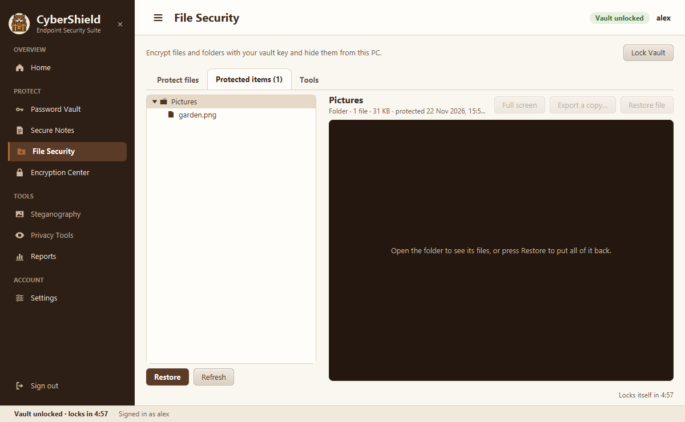
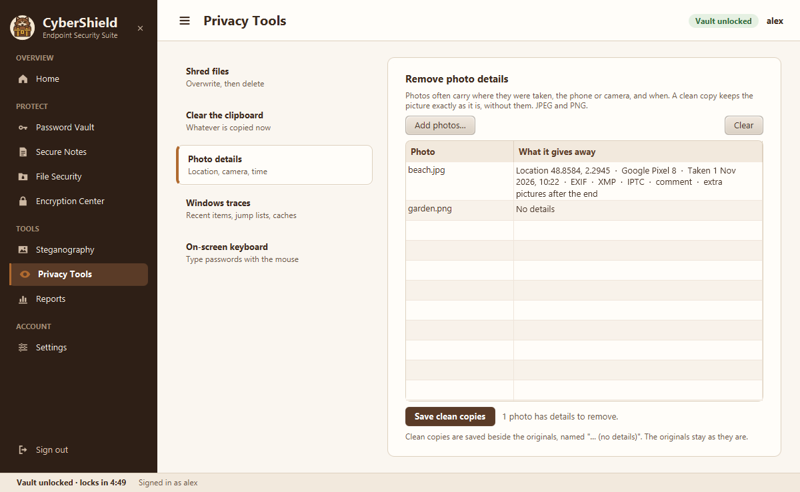
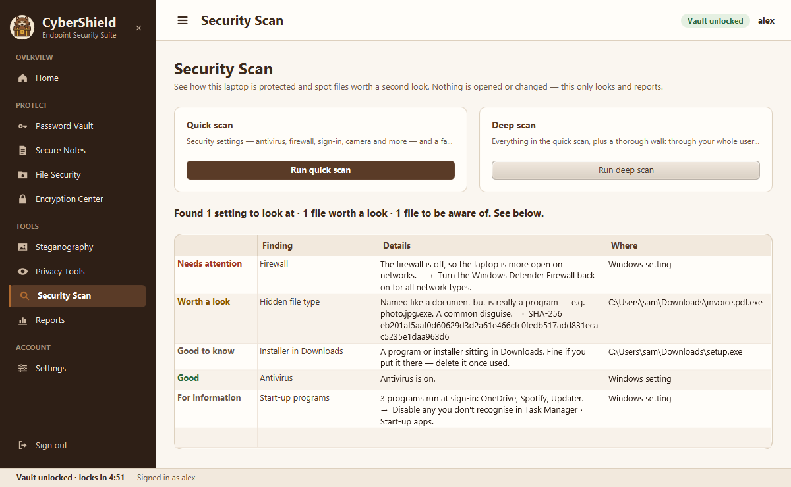
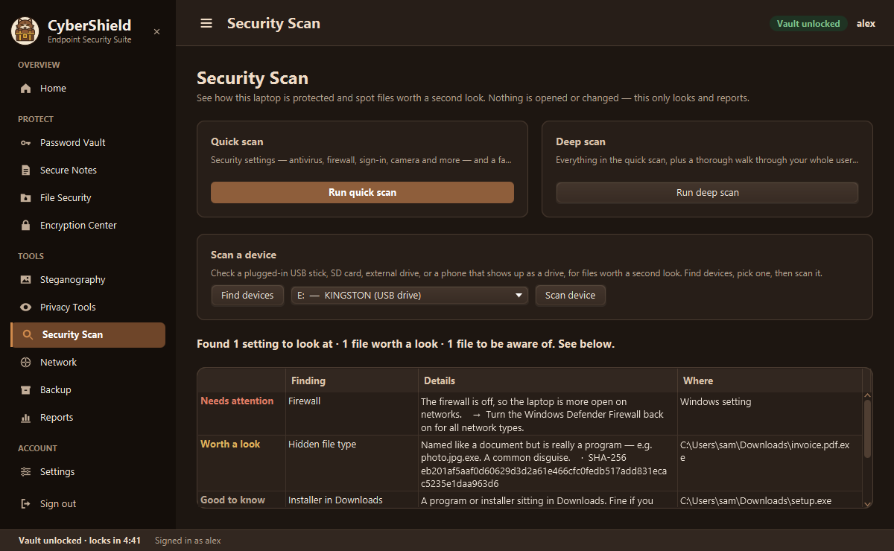
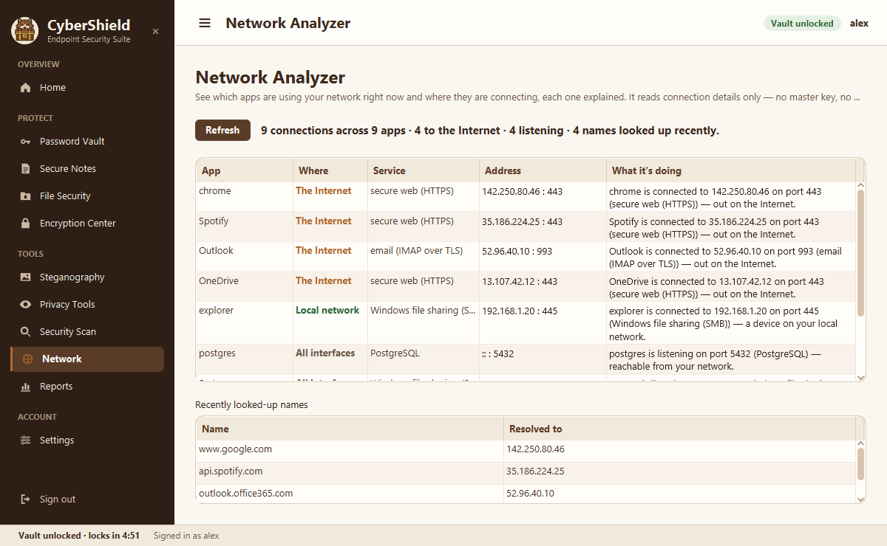
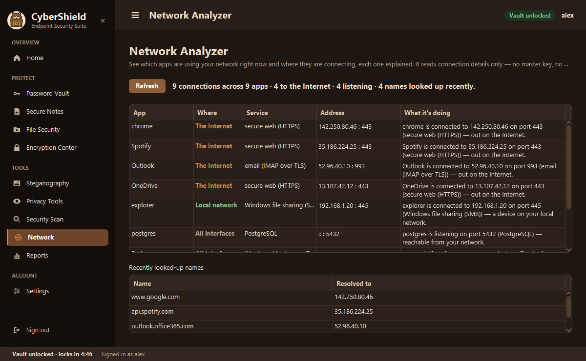
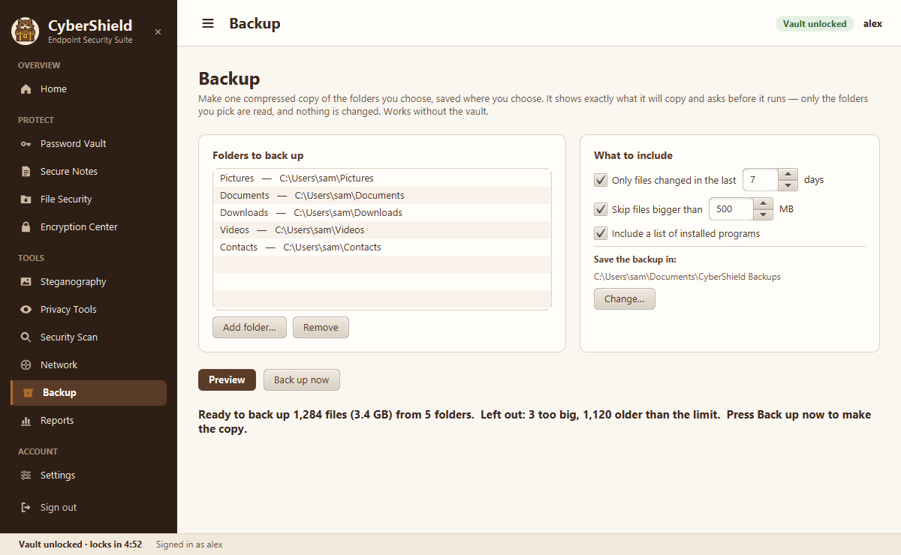
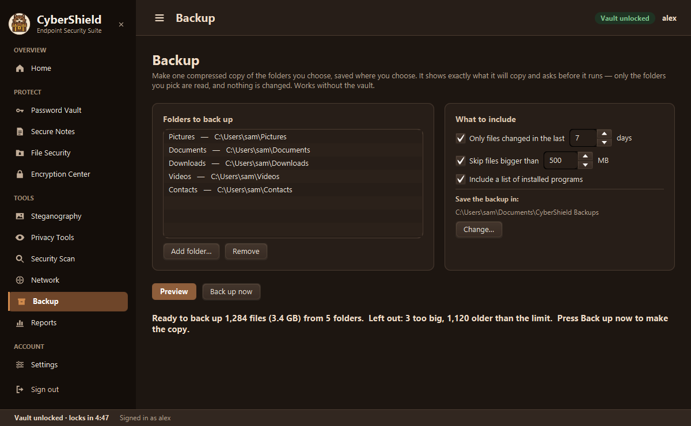
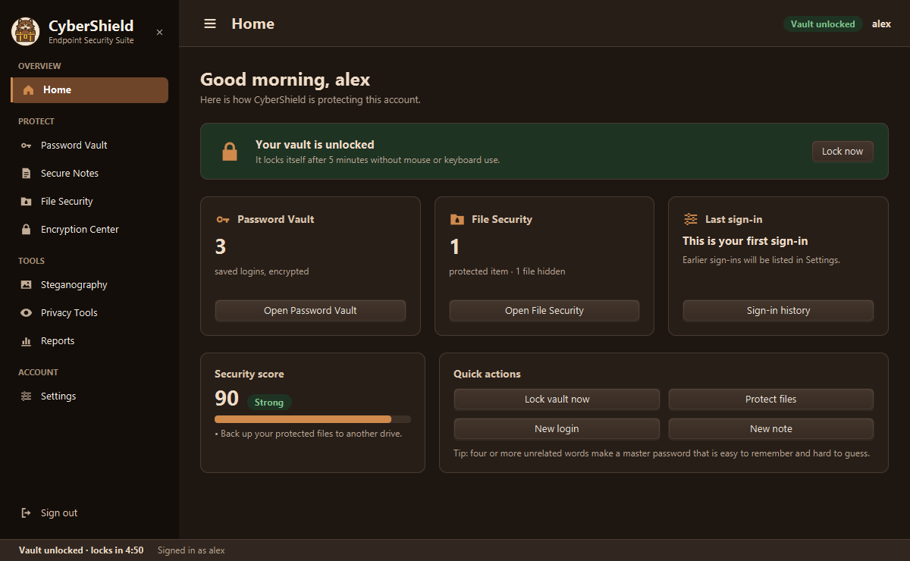

# CyberShield Endpoint Security Suite

[](https://github.com/SHAIKIMRAN01/CyberShield-Endpoint-Security-Suite/actions/workflows/build.yml)

A Windows desktop app that keeps passwords and files private on a shared PC. Every account has its own encrypted vault, and nothing leaves the computer. Built with Java 21, JavaFX 21 and SQLite.


## Features

**Accounts**
- Register and sign in. Mistakes show under the form, and Enter signs in.
- After 5 failed attempts the account waits 30 seconds. The wait doubles with each further failure, up to 15 minutes. Unknown usernames get the same answers and waits, so they don't reveal which accounts exist.
- Every sign-in attempt is recorded (time, computer, result, sign-out time), together with what that sign-in did: files opened, logins and notes changed, tools used. Names in it are encrypted with the vault key. It is all kept for 30 days, and clearing it sooner needs the master password.

**Home**
- The vault state, saved logins, protected files and the last sign-in at a glance.
- A security score from 0 to 100 with the hints that would raise it most, and quick actions.

**Vault (one per account)**
- A master password opens the account's vault, and the vault locks itself after a few idle minutes.
- Changing the master password is instant: only the lock on the vault key changes, not the data.

**Password Vault**
- Save, edit, search and delete logins (Delete asks first). Every field is encrypted.
- Categories and favourites, and sorting by favourites, name, last change or weakest first.
- Password health marks weak, reused and year-old passwords.
- Generator with length, digit and symbol options, and a strength meter.
- Copy with an automatic clipboard clear (the delay is set in Settings).

**Secure Notes**
- Notes encrypted with the vault key, in a searchable list with an editor that saves as you type.
- Copied text clears itself from the clipboard like passwords, and notes leave the screen when the vault locks.

**File Security**
- Pick files and folders from anywhere: browse, tick, drag and drop, or Add files / Add folder.
- They are encrypted into a hidden store and the originals are wiped. Restore puts them back exactly: names, times and attributes.
- A private viewer shows photos, text and code, PDFs, video and music inside CyberShield only, with copying blocked. Photos turn left and right and follow the camera's orientation.
- Videos and songs of any size play straight from the encrypted store: MP4, MOV, MKV, AVI, WebM, phone videos in HEVC, MP3, M4A, FLAC and more. They are decrypted a piece at a time in memory, never written to disk.
- Tools: check every stored file, back the store up to another drive and restore it, and rebuild a lost list from the store.

**Encryption Center** (works without the vault)
- Encrypt text or a file with a password, to share it. Files become `.cshield` files that open on any PC running CyberShield.
- SHA-256 and SHA-512 checksums of text or files, compared with an expected value.
- A password strength checker, and a generator with three modes: random characters (your choice of upper, lower, digits, symbols and length, with an option to leave out look-alikes), a memorable passphrase of words, or a numeric PIN. It shows how many passwords each setting could make.
- Recover a forgotten password to a file **you own** — a `.cshield` file or a password-protected PDF. It tries the passwords people actually choose, from your own hints (a name, a pet, a date, a phone number) and a short common-password list, so it recovers a password you picked, not a long random one. You can import your own contacts (vCard or CSV) as hints.

**Reports**
- A security summary on screen and as a PDF: the score, password health, vault locks, protected files, 30 days of sign-ins and a count of everything done.
- A report never contains passwords, note text, website names or file names. Saved reports are listed with Open, Show in folder and Delete.
- Sign-ins by date: pick any days in the last 30 to see every attempt, with wrong passwords and refused attempts counted, and save it as a PDF.
- A monthly report, if you turn it on: made by itself the first time the vault is unlocked in a month, saved in a folder you choose and listed with the others.
- A PDF of every sign-in: when, on which computer, and everything done, naming the files, logins and notes. Each is kept encrypted with the vault key and opens only inside CyberShield. Sharing one saves a copy protected with a password you choose; sharing or deleting asks for the master password.

**Steganography** (works without the vault)
- Hide a message or a small file inside a picture, locked with a password. Only the lowest bit of some colour values changes, so the picture looks the same.
- Before you start it shows how much fits; afterwards, the picture before and after, and where it changed.
- Reveal a message or file from a picture with the same password. Pictures are saved as PNG, because JPEG (and apps that shrink photos) would wipe what is hidden.

**Privacy Tools** (works without the vault)
- Shred files and folders: each file is renamed, overwritten with random data and deleted. The same safety rules as File Security apply, links and junctions are never followed, and a file open in another program is left whole.
- Clear the clipboard now.
- Photo details: see what JPEG and PNG photos give away (location, camera, time, EXIF, XMP, IPTC, comments, the extra pictures phones add) and save clean copies beside them. The picture isn't re-compressed, and its orientation is kept.
- Clean Windows traces: recent items, jump lists, the thumbnail cache and temporary files older than a day. It looks first and removes only what you tick; files in use are skipped.
- An on-screen keyboard beside the password on the sign-in and vault screens, against keyloggers. Mix the keys puts them in a new order.

**Security Scan** (works without the vault)
- A quick scan reads how the laptop is set up to protect itself — antivirus, firewall, drive encryption, automatic sign-in, lock-on-wake, camera/microphone/location access and start-up programs — and says what's good, what's worth a look and what it couldn't read (which needs an administrator), with advice for each. It reads Windows' own settings and changes nothing.
- A deep scan also walks your whole user folder and points out files worth a second look: a program dressed up as a document (photo.jpg.exe), a hidden program, an installer left in Downloads or a temp folder, a loose script, or something set to run at start-up — each with a SHA-256 fingerprint you can check yourself. These are honest heuristics, not virus detection: CyberShield is not an antivirus and never claims a file is malware.
- Everything is read-only; nothing is opened, moved or changed, and a scan can be stopped at any time.

**Network Analyzer** (works without the vault)
- Press Refresh for a snapshot of how the network is being used right now: every active connection and listening port tied to the app behind it, with a plain-words explanation for each — for example, "chrome is connected to www.google.com (142.250.80.46) on port 443 (secure web/HTTPS) — out on the Internet", or "postgres is listening on port 5432 (PostgreSQL) — reachable from your network".
- Each remote address is resolved to its **website name** by cross-referencing the names Windows looked up (the DNS cache), so a browser's many separate per-site connections read as `www.google.com`, `fonts.gstatic.com` and so on instead of bare IP numbers. Rows are grouped by app, so all of one program's connections sit together.
- The "Where" column is colour-coded so you can see at a glance which connections stay on this computer, which are on your local network, and which go out to the Internet. Well-known ports are named (HTTPS, DNS, email, Remote Desktop, file sharing, and more).
- It also lists the names Windows has looked up recently (the DNS cache), so you can see which sites and services have been contacted.
- It reads connection details only — never the contents of any traffic — needs no administrator, and changes nothing. (Full packet capture needs a driver and an administrator, so CyberShield doesn't pretend to do it.)

**Backup** (works without the vault)
- Make one compressed `.zip` copy of the folders you choose, saved where you choose. It starts with the usual folders (Pictures, Documents, Downloads, Desktop, Videos, and your Windows Contacts), and you can add or remove any folder.
- Filter by what you want: only files changed in the last so-many days (7 by default), and skip anything over a size you set (500 MB by default) — handy for leaving out big videos. You can also include a text list of the programs installed on the PC.
- It **previews first** — showing how many files, how big, and what the filters left out — and copies nothing until you press **Back up now**. Progress is shown, it can be stopped (which removes the half‑written file), and it opens the folder when it's done.
- Only the folders you pick are read, and nothing is changed. It does **not** reach into other apps' private data (such as WhatsApp or text messages) — it copies your own files, not another program's store.

**Settings**
- Light or dark theme, per account. It changes at once, and the sign-in screen shows the theme the last account used.
- Auto-lock minutes and clipboard clear time, per account.
- Change the account password or the master password.
- Sign-in history, with what each sign-in did.
- Back up the protected files to another drive, and restore them (it asks to unlock the vault first if needed).

## Screenshots

| Sign in | Password Vault |
|---|---|
|  |  |
| **Secure Notes** | **Encryption Center** |
|  |  |
| **File Security** | **File Security tools** |
|  |  |
| **Steganography** | **Privacy Tools** |
|  |  |
| **Security Scan** | **Security Scan (dark)** |
|  |  |
| **Network Analyzer** | **Network Analyzer (dark)** |
|  |  |
| **Backup** | **Backup (dark)** |
|  |  |
| **Settings** | **Dark theme** |
|  |  |

## Requirements

- Windows 10 or 11, 64-bit. File Security uses Windows file attributes, and the video player's FFmpeg libraries are the Windows 64-bit ones.
- JDK 21 or newer. Maven compiles for Java 21 (`--release 21`), so nothing newer is used by accident.
- Maven 3.9 or newer.
- For the installer only: WiX Toolset 3.14, which jpackage uses to make the .msi (see below).

**Platforms.** CyberShield is a Windows desktop app and does not run on macOS or Linux (it uses Windows file attributes and junctions, and FFmpeg's Windows 64-bit libraries). You can test it on your own Windows 10/11 PC, in a Windows virtual machine, or on GitHub Actions — every push runs the full test suite on Windows with both Java 21 and Java 25 (`.github/workflows/build.yml`). The tests use their own temp folders and never touch your real accounts or files.

## Run

```
mvn javafx:run
```

From IntelliJ IDEA, open the project as a Maven project and run the `javafx:run` goal from the Maven tool window (Plugins → javafx). That goal passes the one JVM option the video player needs:

```
--add-exports javafx.media/com.sun.media.jfxmedia.locator=ALL-UNNAMED
```

## Install

`CyberShield-1.0.0.msi` installs CyberShield for the Windows user running it, with no administrator rights needed:
- into `%LOCALAPPDATA%\CyberShield App`, with its own Java, so nothing else needs installing;
- with a Start menu entry and a desktop shortcut;
- removable from Settings → Apps → Installed apps.

The app keeps its data in `%LOCALAPPDATA%\CyberShield`, a folder of its own (see below), so removing or upgrading the app leaves accounts, vaults and protected files alone. A newer installer replaces an older one in place.

### Build the installer

```
.\scripts\build-installer.ps1 -Jdk "C:\Program Files\Java\jdk-25.0.2" -WixDir E:\project\tools\wix314
```

It runs the tests, makes a Java runtime with only the modules CyberShield needs (jlink), makes the app folder `target\installer\app-image\CyberShield` (it runs without installing), and packs that same folder into `target\installer\CyberShield-1.0.0.msi`. `-AppImageOnly` stops after the app folder and needs no WiX; `-SkipTests` skips the tests. WiX 3.14 is the `wix314-binaries.zip` of the official [WiX Toolset release](https://github.com/wixtoolset/wix3/releases/tag/wix3141rtm), unpacked into a folder; nothing is installed into Windows.

The tests also run on the bundled runtime, which shows it lacks no module the app uses:

```
mvn test -Djvm=target\installer-runtime\bin\java.exe
```

## Test

```
mvn test
```

GitHub Actions (`.github/workflows/build.yml`) builds and runs every test on each push and pull request, on Windows with Java 21 and Java 25. A version tag such as `v1.0.0`, or starting the workflow by hand, also builds the installer and keeps it with the run. Tests that need JavaFX's own media player check first that JavaFX can play such a file on that computer at all (build servers may have no video decoders or sound device) and are skipped where it can't.

The tests cover:
- encryption and the protected-file format, including tampering, and the Encryption Center's shared text, files and checksums;
- vaults: creating, unlocking, changing the master password, the PBKDF2 upgrade, and taking over the old shared vault;
- sign-in, waits, history and the activity log with its 30-day limit, and registration rules;
- Password Vault and Secure Notes: every field encrypted, older logins converted, password health, privacy between accounts;
- File Security: protect, restore, the safety rules, export, the viewer (photo turns, zoom), the check, recovery and backups;
- video streamed from encrypted files: MKV, AVI, MOV and MP4, big pictures, turned phone videos, seeking, songs, damaged files, and reading any part of a protected file;
- sign-in reports: stored encrypted, shared and deleted only with the master password, private to each account;
- the logo and the opening animation;
- the security score, and reports (no secrets in the PDF), sign-ins by date and the monthly report;
- steganography: messages and files in and out of pictures, wrong passwords, too-big messages, and JPEG wiping the bits;
- Privacy Tools, on made-up files and folders only: shredding (refused places, junctions, open files, stopping), photo details in JPEG and PNG, the traces cleaner, the on-screen keyboard;
- Security Scan: the risky-file rules (disguises, hidden programs, by place, scripts, large files) on made-up names and a temp folder, the posture judgement on made-up settings (good, risky, and "couldn't read" without a guess), the reading of Windows' output, and how findings become rows and advice;
- Network Analyzer: which service a port is, where an IPv4 or IPv6 address sits (this computer, local network, the Internet), the one-line explanation of each connection, and the reading of the snapshot output into connections and look-ups;
- Backup: the date and size filters, the walk of chosen folders on made-up temp files, writing the archive and reading it back, stopping (which leaves nothing behind), de-duplicating clashing names, and the installed-apps list;
- settings, backups from Settings, and every screen opening.

Each test uses its own database and file store in a temp folder, so the real data is never touched. `ScreensTest` opens the screens with JavaFX (in windows that are never shown), so it needs a desktop session.

To save a picture of every screen:

```
mvn test -Dtest=ScreensTest -Dcybershield.snapshots=target/screens
```

## Where data is kept

| What | Where |
|---|---|
| Accounts, encrypted logins, settings, sign-in history | `%LOCALAPPDATA%\CyberShield\Data\cybershield.db`. Older versions kept it in `database\cybershield.db` beside the app: it is copied across on the first start, and the old file stays as it was |
| Encrypted protected files (hidden and system folder) | `%LOCALAPPDATA%\CyberShield\FileVault` |
| A copy of each vault's wrapped key, for recovery | `%LOCALAPPDATA%\CyberShield\FileVault\keys` |
| What each sign-in did (names encrypted), removed after 30 days | the database |
| Backups of protected files | the folder you choose, as `CyberShield backup <date and time>` |
| Reports | the PDF wherever you save it; the list of them in the database |
| Monthly reports | `Documents\CyberShield reports`, or the folder you choose |
| Pictures with something hidden | where you save them, as PNG |
| The log | `%LOCALAPPDATA%\CyberShield\logs\cybershield.log`, kept to five files of 1 MB |
| The installed app | `%LOCALAPPDATA%\CyberShield App` |

The database is not in git (see `.gitignore`). The tests use their own temp folders for all of this.

## Security design

**Account passwords** are stored as BCrypt hashes.

**Vaults**
- Each vault has a random 256-bit key. It is stored only wrapped with AES-256-GCM, under a key derived from the master password with PBKDF2-HMAC-SHA512 (210,000 rounds, 16-byte random salt).
- Changing the master password rewraps that one key in one transaction. Vaults wrapped with fewer rounds are rewrapped on their next unlock.

**Saved data** is encrypted with AES-256-GCM and a fresh 12-byte IV for every value.

**Protected files** use the CSF1 format:
- Every file gets its own random key, wrapped with the vault key.
- Data is encrypted in 1 MiB chunks, with nonces built from a block type and a counter.
- The header is authenticated with every block, so changed, reordered, moved or cut-off blocks are refused.
- An original is replaced only after its encrypted copy has been written, flushed to disk and read back. It is then overwritten and deleted.

**If the database is lost**, the master password and the key file in `keys\` still open the files: File Security → Tools → Recover the list finds them in the store and lists them again.

**Backups** copy the encrypted files as they are, with an encrypted list of them and the vault's key file. Nothing is decrypted, so only the master password opens a backup.

**Shared encryption** (Encryption Center) uses AES-256-GCM with a key derived from the chosen password (PBKDF2-HMAC-SHA512, 210,000 rounds, random salt). Files are sealed in 1 MiB chunks, so a changed or cut-off file is refused, and a wrong password leaves nothing behind.

**Steganography** seals the message or file the same way before hiding it, then spreads it over the lowest bit of the red, green and blue values, behind a short header. Without the password the bits are just noise; a wrong password is refused.

**The log** holds what happened and counts, never passwords, note text, website names or file names. Error messages from Java can name a file, so every folder or file path in a line is replaced with `<path>` before it is written, and accounts appear by number.

**Shredding** renames each file to a random name, overwrites it with random data, flushes it to the disk, empties it and deletes it. The places File Security refuses (drives, the user folder, system and program folders, CyberShield's own files) are refused here too.

**Limits**
- Overwriting a file (File Security, the shredder) doesn't guarantee it is gone from an SSD or a USB stick, and OneDrive or other synced folders keep their own copies.
- Video playback uses an internal JavaFX class, so re-test it when JavaFX is upgraded.
- Video and music play through FFmpeg. If FFmpeg can't load, the viewer falls back to JavaFX's player, which holds a file of up to 1 GB in memory.
- A report is a plain PDF on purpose: it holds no secrets.

### Upgrading from v1

In v1 all accounts shared one vault. The first time an account that has items in it opens the vault after updating, CyberShield asks for that vault's master password once. Its items then move into the account's own vault, with the same key, now wrapped with 210,000 rounds. Accounts with nothing in the shared vault set up their own. The shared vault is removed once no account has items left in it.

## Design

- **Colours:** warm off-white and brown in a 60-30-10 split. Off-white paper covers most of the screen, brown gives the structure (sidebar, headings, main buttons), and one caramel accent marks focus and highlights.
- **Layout:** follows the rule of thirds. Lists, navigation and explanations take one third and the main content the other two, and summary cards come three to a row.
- **Logo:** a brown cartoon wolf guarding a treasure chest (`docs/logo.svg`), drawn from shapes in `ui/Logo.java`, so it is sharp from the window icon up.
- **Opening:** a golden key flies into the chest's lock and turns, the wolf steps back, the lid opens and light fills the screen, then the sign-in screen appears. A click or any key skips it; `-Dcybershield.noIntro=true` turns it off.
- **Sidebar:** the ☰ button (or Ctrl+B) shrinks it to its icons and back; ✕ closes it, and ☰ brings it back.
- **One palette:** every colour has a name in `src/main/resources/css/theme.css` (`-cs-paper`, `-cs-ink`, `-cs-heading` and so on), and the other stylesheets use the names.
- **Dark theme:** `theme-dark.css` gives the same names deep brown values and goes last on each window (`ui/Theme.java`). The sidebar and the sign-in screen's brand panel stay brown; every text colour is at least 4.5:1 against its background.

## Project layout

```
src/main/java/com/cybershield/
  app/          entry point
  config/       the data folder, the database's place, constants
  database/     schema set-up and upgrades
  dao/          users, sign-in history, activity, settings
  encryption/   AES-GCM, PBKDF2, the CSF1 file format, shared files, checksums
  files/        File Security: protect, hide, restore, check, back up, recover
  logger/       the log, on the console and in a file
  notes/        Secure Notes data
  password/     Password Vault data and password health
  privacy/      the shredder, photo details, the Windows traces cleaner
  reports/      security reports, sign-ins by date, the monthly report, a PDF of every sign-in
  security/     BCrypt, session
  services/     sign-in and registration, activity log, security score, the open vault key
  stego/        hiding messages and files in pictures
  vault/        per-account vaults, auto-lock, key backup
  ui/           screens (controllers) and the file viewer
  utils/        validation, generator, formatting
src/main/resources/
  fxml/         screen layouts
  css/          theme.css, theme-dark.css and one stylesheet per screen
  sql/          schema.sql
src/main/packaging/  the installer's icon
src/test/java/  JUnit tests
scripts/        build-installer.ps1
.github/workflows/  automatic builds
```

## Roadmap

| Phase | Weeks | Work | State |
|---|---|---|---|
| 0 · Stabilise | 1–2 | Tests, README, SessionManager fix, header contrast | Done |
| 1 · Accounts & Settings | 2–6 | Registration, sign-in history and waits, one vault per account, Settings, master password change | Done |
| 2 · Core modules | 6–11 | Secure Notes, every Password Vault field encrypted, home screen score | Done |
| 3 · Tools & reports | 11–15 | Encryption Center, PDF reports, File Security backup and recovery | Done |
| 4 · Extras | 16–20 | Steganography, Privacy Tools, sign-ins by date, the monthly report, backups from Settings | Done |
| 5 · Polish & release | 20–21 | Dark theme, logging clean-up, automatic builds, Windows installer | Done |
| Backlog | after 1.0 | The Advanced tasks: charts in reports, importing and exporting logins, password history, start-up options and languages | |

## License

All rights reserved. See [LICENSE](LICENSE).
